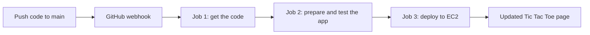

# tech613-ttt-app-cicd-jenkins

This guide explains how the Tic Tac Toe app is connected to Jenkins and deployed. Follow the written steps below; the screenshots are there as a visual reference.

## Contents
- [Prepare the EC2 instance](#1-prepare-the-ec2-instance)
- [Create the SSH key and add it to GitHub](#2-create-the-ssh-key-pair-and-add-it-to-github)
- [Set up the GitHub webhook](#github-webhook-setup)
- [Understand the pipeline](#3-understand-the-pipeline)
- [Set up and run the three Jenkins jobs](#4-set-up-and-run-the-three-jenkins-jobs)
- [Check the final result](#5-check-the-final-result)

## 1. Prepare the EC2 instance

Create an EC2 instance to host the Tic Tac Toe app. Make sure Jenkins can connect to it over SSH, and that users can reach the app through its web port. The exact ports depend on the app and your AWS security group.

## 2. Create the SSH key pair and add it to GitHub

Open **Git Bash**.

Check whether the `.ssh` directory already exists:

```bash
ls -la
```

If the `.ssh` directory does not exist, create it:

```bash
mkdir ~/.ssh
```

Go into the `.ssh` directory:

```bash
cd ~/.ssh
```

Create the SSH key pair:

```bash
ssh-keygen -t rsa -b 4096 -C "<your-email>"
```

This creates two files:

- `<key-name>` is the **private key**.
- `<key-name>.pub` is the **public key**.

To view and copy the public key:

```bash
cat <key-name>.pub
```

The public key starts with `ssh-rsa`. Never share the private key or commit it to GitHub.

### Add the public key as a GitHub deploy key

1. Open the repository on GitHub and go to **Settings → Security → Deploy keys**.
2. Select **Add deploy key** and enter a clear title.
3. Paste the contents of the `.pub` file into the **Key** field.
4. Turn on **Allow write access** only if Jenkins needs to push changes to GitHub. Leave it off if Jenkins only needs to read the code.
5. Select **Add key**.

### How the GitHub key is used

```text
Jenkins keeps the private key
          |
          v
GitHub checks it against the public key
          |
          v
The deploy key gives Jenkins access to the repository
```

Jenkins keeps the private key as a credential. GitHub stores the matching public key. This lets Jenkins connect without a GitHub password.

> **Keep the keys safe:** The private key must stay in Jenkins Credentials. Add only the public key to GitHub. Use a separate key for connecting Jenkins to the EC2 app server.

## GitHub webhook setup

A webhook tells Jenkins when code is pushed to GitHub, so you do not need to start Job 1 by hand.

1. In GitHub, open the repository and go to **Settings → Webhooks**.
2. Select **Add webhook**.
3. Enter the Jenkins webhook address as the **Payload URL**:

```text
http://52.31.15.176:8080/github-webhook/
```

4. Choose **push events**.
5. Select **Add webhook** to save it.
6. In Jenkins Job 1, enable **GitHub hook trigger for GITScm polling**.

## 3. Understand the pipeline

When someone pushes a change to the `main` branch, GitHub notifies Jenkins. Jenkins then runs the jobs in order:



This setup helps the team because it repeats the same steps for every change, finds problems earlier, and reduces manual deployment work. For an organisation, it also makes releases easier to follow because each job has a build result and log.

## 4. Set up and run the three Jenkins jobs

Create each job as a **Freestyle project** if that is what your Jenkins screenshots show. Use the repository address, branch, job names, and commands that match your own setup. Do not paste passwords or private keys into a job command or this README; select stored Jenkins credentials instead.

### Job 1: Get the latest code

1. In Jenkins, select **New Item**, enter the Job 1 name, choose **Freestyle project**, and select **OK**.
2. In **Source Code Management**, choose **Git** and enter the repository URL.
3. Select the Jenkins credential that contains the GitHub SSH private key. Set the branch to `*/main` if the job should use the `main` branch.
4. Under **Build Triggers**, enable **GitHub hook trigger for GITScm polling**. This is what lets the webhook start the job after a push.
5. Save the job. Push a small change to GitHub and check that Job 1 starts and checks out the new code.

Job 1 should finish successfully and show the latest commit in its build log. If it cannot connect to GitHub, check the repository URL and the selected SSH credential.

### Job 2: Prepare the app

1. Create Job 2 as a **Freestyle project** and enter the settings shown in the Job 2 screenshot.
2. Set it to run after Job 1 succeeds. In **Build Triggers**, use **Build after other projects are built** and select Job 1, if that is how your Jenkins setup is linked.
3. Add the build or test step shown in your Jenkins configuration. The app is in the `app` folder. For example, `cd app && npm test` runs its automated tests.
4. Save the job, then run it once. Check the console log and make sure the build finishes successfully before moving on.

Job 2 prepares the version that Job 3 will deploy. If it fails, read the console log, fix the reported problem, and run the job again.

### Job 3: Deploy the app to EC2

1. Create Job 3 as a **Freestyle project** and enter the settings shown in the Job 3 screenshot.
2. Set it to run after Job 2 succeeds, using **Build after other projects are built** if that is how your Jenkins setup is linked.
3. In Jenkins **Manage Jenkins → Credentials**, add an **SSH Username with private key** credential for the EC2 server. Enter the EC2 login name and the private key that matches the public key installed for that server. Give the credential a clear ID.
4. In Job 3, select that credential in the SSH or deployment setting. Keep the private key out of the job text and build logs. Limit SSH access in the EC2 security group to the Jenkins server where possible.
5. Save and run Job 3. Check the console log to confirm that Jenkins connected to EC2 and the app started.

Job 3 should report success after the new app version is running. If the connection fails, check the EC2 address, login name, selected credential, and SSH access rules. Do not print or share the private key while troubleshooting.

### Jenkins job screenshots

The screenshots show the Jenkins job settings. Use the steps above to understand what to enter and why; do not rely on the images alone.

#### Job 1


#### Job 2


#### Job 3


## 5. Check the final result

After a push to `main`, check that:

1. GitHub sends the webhook and Job 1 starts.
2. Jobs 1, 2, and 3 all finish successfully in order.
3. The Tic Tac Toe homepage opens at the app's public address and shows the updated version.

The final result is a working homepage with the latest change. Add a screenshot of that updated homepage here so readers can compare it with the Jenkins job screenshots.
